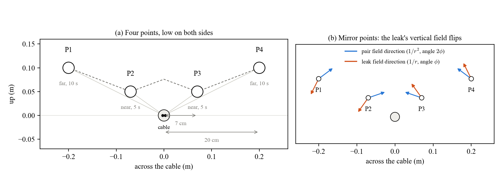

English | [简体中文](FOUR-POINT.zh-CN.md)

# The four-point scan

## Why four points

The field of a twin-conductor cable at radius $r$ and azimuth $\phi$ (measured
from the horizontal axis across the cable) is the sum of a dipole term from the
load current $I$ and a monopole term from the leakage current
$I_\mathrm{leak} = I_L - I_N$ (Eq. (1) of the paper):

$$
\vec B = \frac{\mu_0 I d}{2\pi r^{2}}
\begin{pmatrix} -\sin 2\phi \\ \cos 2\phi \end{pmatrix}
+ \frac{\mu_0 I_\mathrm{leak}}{2\pi r}
\begin{pmatrix} -\sin \phi \\ \cos \phi \end{pmatrix}
+ \vec U ,
$$

where $d$ is the conductor spacing and $\vec U$ is the uniform coherent
background the fit carries as a nuisance term. With $d = 5.5$ mm, a 10 A load
and a 30 mA leak, the dipole is 31 times the leak at 6 cm; even at the bench's
2.1 A it is about 5 times a 29 mA leak at the near points. The leak has to be
separated by its *shape*, not by its size.

Reflect a point across the vertical plane through the cable,
$\phi \to \pi - \phi$. Then $\sin\phi$ and $\cos 2\phi$ keep their sign while
$\cos\phi$ and $\sin 2\phi$ flip:

| Field term | across, mirror point | up, mirror point |
| --- | --- | --- |
| pair (dipole) | flips | **same** |
| leak (monopole) | same | **flips** |
| background $\vec U$ | same | **same** |

So the difference of the vertical field between a point and its mirror image
cancels the pair and the background exactly and doubles the leak:

$$
B_\mathrm{up}(\pi - \phi) - B_\mathrm{up}(\phi)
= -\,\frac{\mu_0 I_\mathrm{leak}}{\pi r}\cos\phi .
$$

*Figure 1. (a) The four points relative to the cable as the guide places them
for the magnetometer: far points at (∓20, 10) cm held 10 s, near points at
(∓7, 5) cm held 5 s. (b) Field directions from Eq. (1) at the four points: the
pair field mirrors with the same vertical component, the leak field with the
opposite one.*

This one identity dictates the design:

- **Both sides.** One side alone cannot tell a leak from a healthy cable,
  because the leak's signature is the left/right *difference*.
- **Low, not above.** The useful leak component scales as $\cos\phi$. Directly
  above the cable ($\phi = 90^\circ$) it vanishes. In the design study, points
  at $45^\circ$ measured the leak about half as well as points at $25$ to
  $30^\circ$ above the horizontal.
- **Two radii.** At a single distance, the leak's $1/r$ term and the uniform
  $\vec U$ can trade against each other. A second pair at a different radius
  separates them. Three points (one pair plus one point above) are exactly
  determined and fail in practice.
- **Holding still.** A block counts only if the sensor moved less than 5 cm
  within it. Time spent walking long arcs is mostly lost to this gate; time
  spent holding at a point is not.

A Cramér–Rao and Monte-Carlo study through the unchanged fit (30 s of data,
29 mA leak, MMC5983MA noise, realistic pose and mount errors) gave the four-point
design a 29 mA reading of 25.9 to 32.5 mA and no false alarms on healthy cables.
Freehand arcs of the same duration read 27.8 to 42.0 mA and raised false alarms
on 15 % of healthy runs. The design stayed robust to 3 to 6° of sensor-mount
error, a leak return conductor 0.4 to 1 m away, and 1 cm of VIO drift. It broke
with 3 cm of drift.

## Citation

The four-point scan is part of WireCheck. If you use it, please cite:

> Xincheng Xie and Akarsh Prabhakara. 2026. Demo: Locating Leakage Current via Magnetometers. In *The 32nd Annual International Conference on Mobile Computing and Networking (MobiCom '26)*. ACM. https://doi.org/10.1145/3795866.3848441

BibTeX: see [README.md](README.md#citation).
