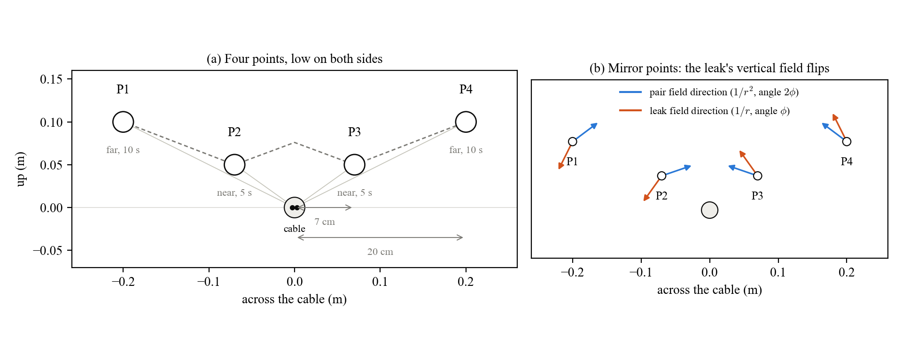

[English](FOUR-POINT.md) | 简体中文

# 四点扫描

## 为什么是四个点

双导线电缆在半径 $r$、方位角 $\phi$（从横跨电缆的水平轴量起）处的磁场，是负载电流 $I$ 产生的偶极项与漏电流 $I_\mathrm{leak} = I_L - I_N$ 产生的单极项之和（论文式 (1)）：

$$
\vec B = \frac{\mu_0 I d}{2\pi r^{2}}
\begin{pmatrix} -\sin 2\phi \\ \cos 2\phi \end{pmatrix}
+ \frac{\mu_0 I_\mathrm{leak}}{2\pi r}
\begin{pmatrix} -\sin \phi \\ \cos \phi \end{pmatrix}
+ \vec U ,
$$

其中 $d$ 为导体间距，$\vec U$ 为拟合中作为干扰项的均匀相干背景场。取 $d = 5.5$ mm、10 A 负载、30 mA 漏电，在 6 cm 处偶极项是漏电项的 31 倍；即使在台架的 2.1 A 下，近点处它也约是 29 mA 漏电的 5 倍。漏电必须靠它的*形状*而不是大小来分离。

把一个点关于过电缆的竖直平面做镜像，$\phi \to \pi - \phi$。此时 $\sin\phi$ 与 $\cos 2\phi$ 符号不变，$\cos\phi$ 与 $\sin 2\phi$ 变号：

| 场项 | 横向，镜像点 | 竖直，镜像点 |
| --- | --- | --- |
| 对偶（偶极） | 变号 | **相同** |
| 漏电（单极） | 相同 | **变号** |
| 背景 $\vec U$ | 相同 | **相同** |

因此一个点与其镜像点的竖直场之差恰好消去对偶项与背景，并使漏电项加倍：

$$
B_\mathrm{up}(\pi - \phi) - B_\mathrm{up}(\phi)
= -\,\frac{\mu_0 I_\mathrm{leak}}{\pi r}\cos\phi .
$$

*图 1. (a) 引导程序为磁力计放置的四个点（相对电缆）：远点位于 (∓20, 10) cm，停留 10 s；近点位于 (∓7, 5) cm，停留 5 s。(b) 由式 (1) 得到的四个点处的场方向：对偶场镜像后竖直分量相同，漏电场镜像后竖直分量相反。*

这一个恒等式决定了整个设计：

- **两侧都要。** 只在一侧无法区分漏电与健康电缆，因为漏电的特征是左右之*差*。
- **低位，而不是正上方。** 有用的漏电分量按 $\cos\phi$ 变化。在电缆正上方（$\phi = 90^\circ$）它为零。在设计研究中，位于 $45^\circ$ 的点对漏电的测量效果约为位于水平面上方 $25$ 到 $30^\circ$ 的点的一半。
- **两个半径。** 在单一距离上，漏电的 $1/r$ 项与均匀的 $\vec U$ 可以互相抵换。另一半径上的第二对点把它们分开。三个点（一对加正上方一点）恰好定解，实际中会失败。
- **保持静止。** 只有块内传感器移动小于 5 cm 的块才计入。走长圆弧的时间大多被这个门限丢掉；在点上停留的时间则不会。

通过未改动的拟合做的 Cramér–Rao 与蒙特卡罗研究（30 s 数据，29 mA 漏电，MMC5983MA 噪声，真实的位姿与安装误差）表明：四点设计对 29 mA 的读数为 25.9 到 32.5 mA，健康电缆上没有误报。同样时长的徒手圆弧读数为 27.8 到 42.0 mA，在 15 % 的健康运行中误报。该设计对 3 到 6° 的传感器安装误差、0.4 到 1 m 外的漏电回流导线以及 1 cm 的 VIO 漂移都稳健；漂移达到 3 cm 时失效。

## 引用

四点扫描是 WireCheck 的一部分。如果你使用了它，请引用：

> Xincheng Xie and Akarsh Prabhakara. 2026. Demo: Locating Leakage Current via Magnetometers. In *The 32nd Annual International Conference on Mobile Computing and Networking (MobiCom '26)*. ACM. https://doi.org/10.1145/3795866.3848441

BibTeX：见 [README.zh-CN.md](README.zh-CN.md#引用)。
